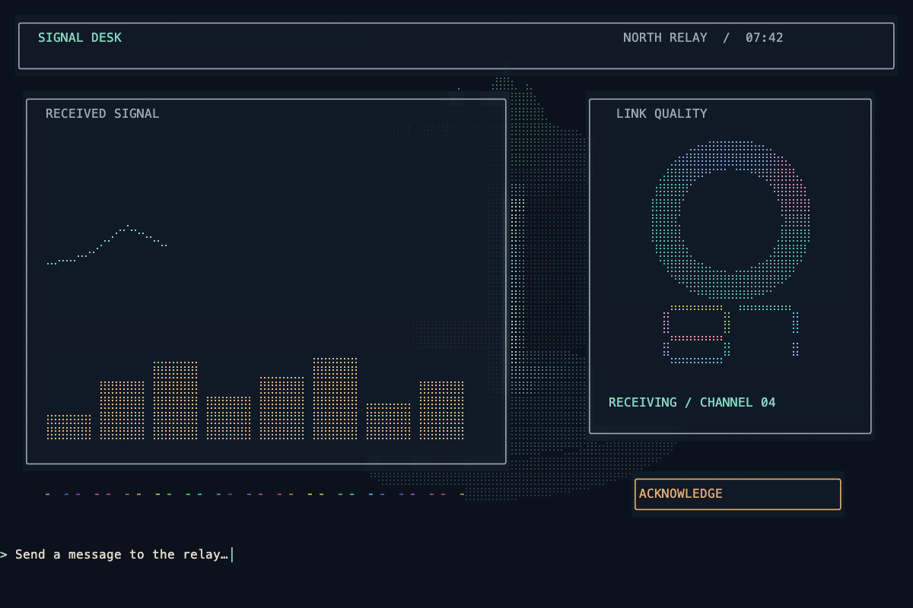
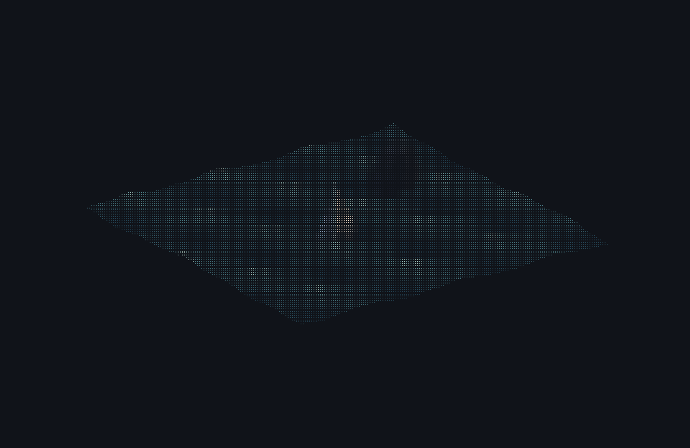
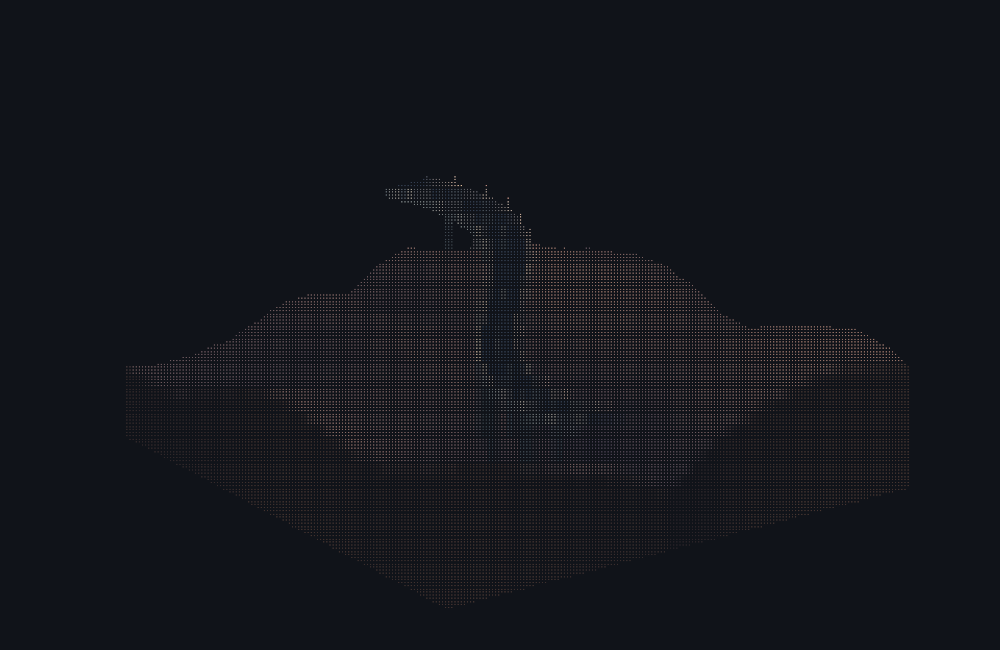
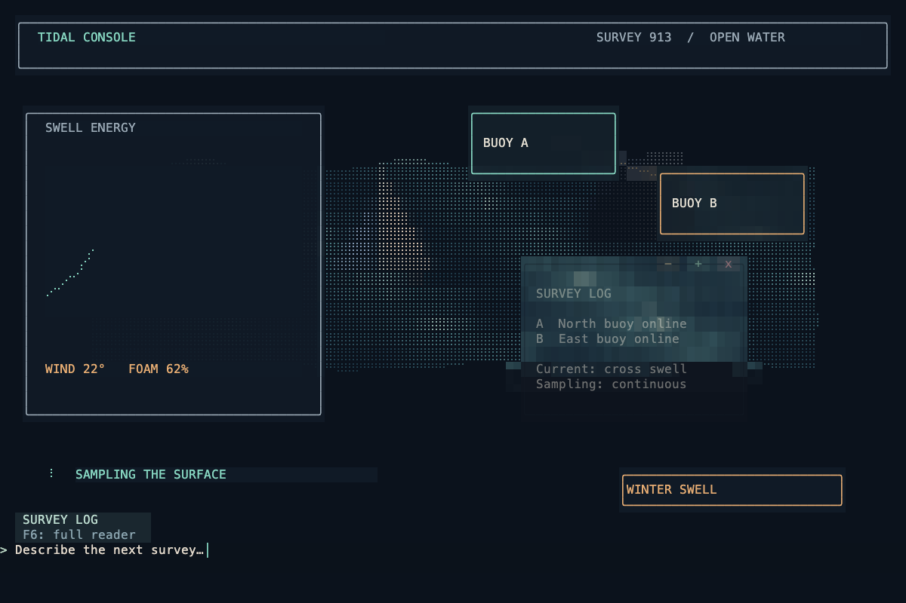

# Nocturne

Nocturne is a movement-and-color-first TUI SDK. It draws terminal interfaces as living scenes: weather that rises from what you type, text that arrives as ink, windows that unfold, light that moves across water and terrain, cameras that fly. Every frame is Unicode cells with true foreground and background color, so the same scene runs in a terminal or a web browser.

The renderer is a C11 core. C, WebAssembly/TypeScript, Python, Go and Rust applications drive the same command contract, scene state and rendering pipeline, and an exported project draws byte-identical frames in each of them.

Version `1.0.0` ([CHANGELOG.md](CHANGELOG.md)). The Gallery shows the original artwork of Nocturne explorations 0.1 through 0.9 and the recipes built on it. Licensed under MIT.

[Website](https://nocturne.arf.io) · [Releases](https://github.com/arf-io/nocturne-tui-sdk/releases) · [Documentation](docs/current/README.md) · [Command reference](docs/current/Commands.md) · [Build your own scene](docs/current/Composition.md)

## What you can build



**Signal Desk** combines a waveform, bar chart, status panel, animated indicator, button and editable prompt. The Gallery lets you move and resize these elements, change their appearance and export the composition as a runnable application.

| Feature | Included functionality |
|---|---|
| Controls and panels | 18 widget kinds: text, box, rule, item, cursor, progress, bars, pie, donut, scatter, line, digits, edge, button, checkbox, radio, select and scrollbar. |
| Windows and applications | Window placement, borders, transparency, content, focus, selection, modal input and application views. |
| Text | Unicode input and selection, document views, text transitions, prompt presentations, custom cursors, blink timing and animated cursor colors. |
| Typing weather | Embers, sparks, nova, rain, snow and ripples emitted by accepted input, with intensity, lifetime, speed and paste controls. |
| Geometry | Braille dot sampling, half-cell and cell rendering, curves, meshes, surfaces, spatial graphs and projected text. |
| Scenic animation | Pearl Cascade, Copper Causeway, Tidal Glass, Silt, particles, leaves, fluid motion, electrical effects and layered backgrounds. |
| Cameras | Orbit, head, dolly, crane/jib, follow/chase and spacecraft rigs; configurable axis actions, anchors, pan, rotation, roll and scripted flight. |
| Materials | Foreground and background color, gradients, opacity, animated color and palette selection. |
| Assets | OBJ model import, TDF artwork and TrueType/OpenType font tooling. Asset loading and font presentation depend on the chosen host. |
| Application state | Typed values, bindings, triggers, scheduled commands, semantic hit testing and snapshots. |

The [component atlas](docs/current/Components.md) contains 100 captured states across 49 component families. It covers the controls, scene components and composed examples.

## Spatial scenes



**Tidal Glass** combines wave geometry, a boat and a rock under a movable camera. **Copper Causeway** places a suspended road over terrain; **Silt** shows a cut landscape and river. **Pearl Cascade** presents moving water and spatial geometry.



Select a scene in the Gallery, then use its camera and scene controls. The mouse wheel changes distance to the subject with the default camera mapping. Drag establishes an anchor for orbit; the camera controls expose other rigs and axis mappings. Scene time advances independently of camera movement.

Braille uses a 2 × 4 dot grid in each cell. Cell, half-cell and braille sampling are available for different materials and surfaces. See [materials and rendering](docs/current/Materials-and-Rendering.md) for color, sampling, compositing and depth.

## Gallery and Workshop

The **Gallery** is the visual design environment. Its viewport stays visible while tools scroll beside it or below it on smaller screens.

- Browse the original artwork: every scene, effect, weather, window treatment and typography from the Nocturne explorations, each with its provenance. Attract mode tours them in random order.
- Start with Signal Desk, Flight Deck or Tidal Console, or create a panel.
- Add components, drag them into place, resize them and adjust their properties.
- Set colors, opacity, borders, materials, prompt appearance and typing weather.
- Switch between Design and Interact modes to edit a layout or operate its controls.
- Undo and redo changes, import or export a project, and generate application code.

The **Workshop** exposes commands, typed fields and generated code for developers. It shares the Gallery project model. Export a project and it runs as a WASM/TypeScript, Python, Go or Rust program that carries the authored scene, assets, clock and interaction commands, and draws the same frames in each. Import OBJ models, compose your own scenes, materials and choreography, and ship them to any of the five targets.



Open the Gallery HTML from [GitHub Releases](https://github.com/arf-io/nocturne-tui-sdk/releases) in a browser to use both environments. The file includes its WebAssembly runtime and browser modules, so the built-in scenes need no application server. Browser permission rules apply to file, clipboard and device access.

## How it works

Your application owns input, time, files, devices and output. Nocturne owns the scene and its simulation.

```text
Application input, time and data
              |
       Language binding
              |
     Commands -> C11 scene
              |
    Geometry and compositing
              |
 Unicode cells + colors + semantic IDs
              |
      Terminal or web presenter
```

Submit commands to create or update elements. Advance the scene to an explicit time, then render its cell frame. Rendering does not advance animation. A cell contains a Unicode scalar, foreground RGB, background RGB and semantic identity; the presenter paints it and routes input back to the application.

A project stores editable components, assets and interactions. A snapshot stores a runtime checkpoint. Document storage grows with available memory; the visible cell frame is only a view of that content. A rejected transaction leaves the scene unchanged. The [SDK contract](docs/current/Contract.md) describes ownership, persistence, finite resource pools and error handling.

## Build and run

Native builds need Python 3.10 or later and a C11 compiler. Building WebAssembly and the Gallery also needs Clang, `wasm-ld` and TypeScript. Set `CC`, `WASM_CC` and `WASM_LD` when your tools are not on `PATH`. The build scripts do not install dependencies.

The test runner (`qualify-native.sh`) needs Python 3.11 or later and the packages pinned in [tools/requirements-qualification.txt](tools/requirements-qualification.txt). `python3 tools/bootstrap.py` installs them into `.venv`.

```sh
sh build-native.sh
sh run-native.sh --scene autumn --fps 60
```

Build only the native library:

```sh
sh build-native.sh --native-only
```

A small Python scene, after building or installing the matching SDK library:

```python
from nocturne_native import NativeScene

with NativeScene() as scene:
    scene.command({"op": "resize", "width": 80, "height": 24})
    scene.command({
        "op": "widget", "id": 1, "kind": "progress",
        "x": 4, "y": 8, "width": 60, "height": 3,
        "border": "rounded", "value": 0.65,
    })
    scene.advance_to(250_000)
    frame = scene.render()
    print(frame.width, frame.height, len(frame.bytes))
```

Add `native/bindings/python` to `PYTHONPATH` when running from this checkout. The example returns a cell frame; your host presents it. [Getting started](docs/current/Getting-Started.md) and the language references have complete integration examples.

## SDK references

| Integration | Guide |
|---|---|
| C | [Contexts, buffers, ABI and queries](docs/current/C.md) |
| WebAssembly / TypeScript | [Browser and Node scenes](docs/current/WASM-TypeScript.md) |
| Python | [NativeScene and Python hosts](docs/current/Python.md) |
| Go | [Scene ownership, cgo and Bubble Tea](docs/current/Go.md) |
| Rust | [Scene ownership, FFI and Ratatui](docs/current/Rust.md) |
| Web applications | [Canvas, DOM, input and accessibility](docs/current/Web.md) |
| Composition | [Projects, assets, events and code generation](docs/current/Composition.md) |
| Input and motion | [Cameras, flight, prompts and text](docs/current/Input-and-Motion.md) |
| GUI SDK | [Implementation prompt](docs/current/Nocturne-GUI-SDK-Prompt.md) |

The documentation is Markdown. The SDK builds HTML and nine PDFs from it: a reference for each language, a web guide and the GUI SDK prompt.

Native libraries are platform-specific, so rebuild the library for each platform. Use the bindings and runtime from the same SDK version. The WebAssembly build runs through the TypeScript binding in a browser or Node.

## Run the tests

List or run the standard test profile:

```sh
sh qualify-native.sh --profile rc2 --strict --capture --list
sh qualify-native.sh --profile rc2 --strict --capture
```

The profile builds the library and bindings, replays scenes in all four languages, and checks rendering, cameras, the browser editor, generated applications and the documentation. Each run writes a report of the steps it ran.

## Report an issue

Use [GitHub Issues](https://github.com/arf-io/nocturne-tui-sdk/issues). Include the SDK version, platform, binding, a minimal command sequence or project, and the observed result. For a visual problem, include the scene name, sampling mode, camera settings and a screenshot.

Unicode data terms are in the [Unicode license](native/unicode/17.0.0/LICENSE.txt). Check the applicable licenses before redistributing imported fonts or models.
