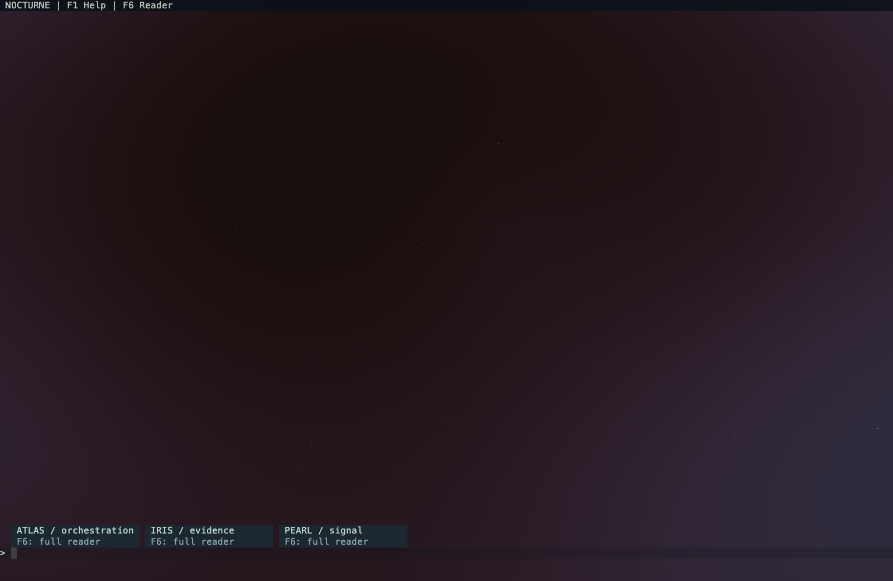

# Composition and generated applications

## One model for Gallery and Workshop

Gallery edits visible elements. Workshop edits the same project as structured data and native commands. Geometry, element identity, z-order, materials, actions and owned assets belong to that project. Runtime interaction state belongs to its scene. Selection handles and editor focus are host UI, not additional artwork in the native frame.

Use the shared `composition_project.mjs` implementation to normalize and validate projects. Use `composition_codegen.mjs` for executable language exports. Do not rebuild command ordering independently for each language. Exported programs consume the normalized scene plan and expose input/time interaction points through the actual SDK.

## Replace versus insert

Replacing a project starts from its declared seed and resources in a fresh trial scene. A valid result replaces the live scene atomically. Adding or duplicating a component in the editor allocates the next element ID. `insertProject` preserves incoming IDs and rejects any collision; it accepts elements only, so scene commands or model resources require Replace.

Inspector edits are validated in the trial scene and adopted through snapshot restoration. A drag previews coordinates during motion and commits its resulting checkpoint on release. Numeric geometry fields and keyboard movement edit the same project. Element dimensions are positive integers. Project viewports accept 4–512 columns and 2–256 rows; this authoring-model range is separate from native render-buffer growth. Raise and Lower reorder elements within World or Interface groups; native depth and component layering still determine painting.

## Resources and layers

Materials, areas, surfaces, paths and imported models have identities and dependencies. Create dependencies before consumers. Remove or detach consumers before removing their resources. Project model resources use canonical base64 records. The importer validates plain JSON and rejects unsupported fields; it does not evaluate JavaScript or fetch external textures.

The placement catalogue contains the 18 widget kinds listed in [Components](Components.md), plus window, emitter, field, text-transition, graph-node, area, indicator, mesh, surface, cell-art and stage-component. Native windows and widgets have different geometry contracts. Windows are projected panels in world space; widgets use screen cells. The placement adapters translate project geometry to each native contract. World elements use the project XY plane at z=0; their placement is not automatic screen projection under an arbitrary camera. Scene presets author the camera for that geometry. Scene bases retain native scene commands; Studio, Fleet and Observatory applications remain separate Gallery routes.

## Appearance and presets

Supported elements expose local foreground, background, opacity and border controls. Inherit removes the local override. The compiler reserves native material slots 0–15, reuses matching colors and rejects exhaustion rather than replacing another material. `componentAppearance(kind)` returns the supported fields for a particular element.

Signal Desk, Flight Deck and Tidal Console are complete editable projects. Load them as scene bases, then place supported elements or edit their native data.

## Events and undo

Keep design undo separate from text editing undo. Bind an application action to a semantic identity and explicit event kind. Route accepted input through the native owner so a modal or reader cannot leak keystrokes into the prompt. Scene animation continues unless the application deliberately pauses it.

Project history stores owned project revisions and checkpoint deltas. Undo and redo restore the corresponding scene, including assets and configuration. Invalid imports and failed trial-scene transactions preserve the live project. Selection-only changes do not add history entries.

## Exported application contract

Generated TypeScript, Python, Go and Rust programs consume the same normalized scene plan, seed, resources and time. They expose the scene and activation helpers for application input and further advancement. Element IDs remain stable in the generated native transactions.

The language references describe loading, frame ownership, error handling and host integration. Generated program usage instructions accompany their files. Keep the exported project JSON alongside the program so the same design can be reopened in Gallery.

## Project API

`CompositionProject` uses schema `nocturne.project.v1`. It stores name, seed, viewport dimensions, background, timeUs, native commands, optional model records, prompt data and ordered elements. `timeline` is an ordered list of `{timeUs, command}` actions; omitted timelines normalize to an empty list. `final` is an optional/default-empty command list applied after reaching the saved view time. `initialPromptText` optionally supplies the starting text for replay while `prompt.text` represents the saved content. Each element has a stable ID, native kind, name, x/y/width/height geometry, properties and an activation command list. Imported JSON is validated before adoption.

| Function | Purpose |
|---|---|
| createProject | Create a project with explicit seed and viewport |
| placeComponent | Create one of the 29 supported element kinds |
| validateProject / importProject / exportProject | Own and validate JSON data |
| projectPlan | Compile the normalized native command/resource/interaction plan |
| advanceProject | Advance time and consume due host timeline commands |
| componentAppearance | List the appearance fields supported by an element kind |
| prepareProject | Validate in a scene and obtain owned snapshot/frame/metadata |
| adoptProject | Commit a prepared project to the destination scene |
| insertProject | Insert element data with unchanged IDs; reject collisions and resources |
| projectActivation | Resolve an element's native activation transaction |
| ProjectHistory | Commit, undo and redo project plus matching native checkpoints |
| generateProjectFiles | Export actual executable language files and project data |

The generated directory belongs beside the SDK `native/` directory. Files include `panel.mjs`, `panel-node.mjs`, `panel.ts`, `panel.py`, `main.go`, `go.mod`, `src/main.rs`, `Cargo.toml`, `project.json`, `README.md` and `model.bin` when needed. JavaScript exposes `createPanel(wasm, modelBytes)`, render/advance/activation and input helpers. Native programs expose their actual scene and activation function for host integration. The included README gives exact commands.

Generated advancement consumes future timeline events in order and preserves explicit frame-budget behavior. Saved current-view overrides run after replay; they are not substituted for the events that produced the state.

An exported activation ID invokes a declared native transaction. It is not a shell command, network request or imported executable script. Keep application side effects outside the project evaluator.
