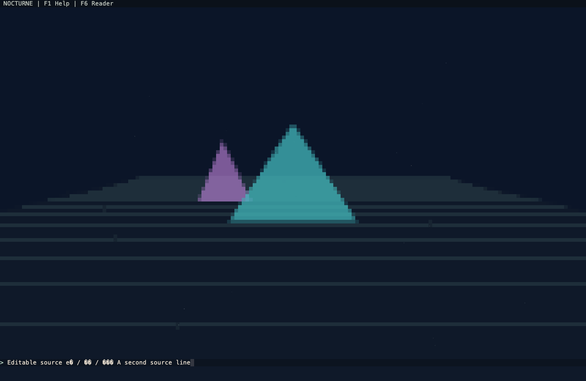
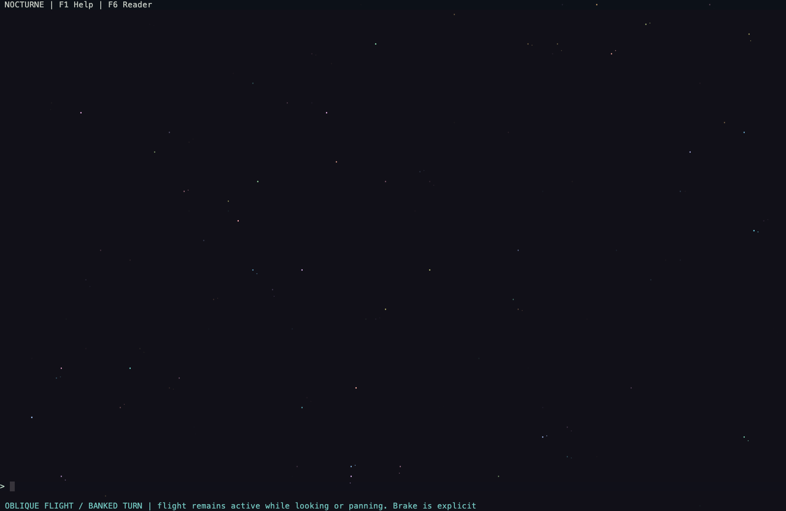

# Input and motion

## Prompt and Unicode

The prompt stores complete editable Unicode. Caret and selection coordinates in commands use Unicode scalar offsets, not JavaScript UTF-16 indices or encoded byte offsets. Use binding document/grapheme queries for cursor motion, hit testing and display wrapping. Large document storage grows through caller-owned native arenas or binding allocations; explicit application limits remain application policy.

Browser IME preedit stays local until composition ends. Commit the accepted text once, then read native text and selection back. A decorative weather queue must never prevent text from being accepted. Clipboard reads, OS notifications and external links remain host responsibilities.



## Cursor and typing weather

Use `prompt-appearance` without enabling a window application. Cursor shape can inherit the active presentation, be hidden, or use block, half, underline, bar, braille or one custom scalar. Ink can be fixed, pulse between two colors, or cycle hue. The current values are native state and survive snapshot/replay.

```json
{"op":"prompt-appearance","cursor":{"shape":"bar","color":"#a3cabe","secondaryColor":"#c7aed7","blinkMs":600,"duty":0.5,"colorMode":"pulse","colorPeriodMs":2000},"weather":{"style":"embers","intensity":0.6,"lifeMs":1800,"speed":12,"paste":"burst"}}
```

| Field | Domain |
|---|---|
| Cursor blinkMs | 0 for steady, or40..60000 milliseconds |
| Cursor duty | 0..1 fraction visible |
| Cursor colorPeriodMs | 40..60000 milliseconds |
| Cursor glyph | One printable Unicode scalar |
| Weather style | off, embers, sparks, nova, rain, snow, ripples |
| Weather intensity | 0..1 |
| Weather lifeMs | 200..8000 milliseconds |
| Weather speed | 1..50 |
| Paste policy | each, burst, off |

Reduced motion suppresses cursor blinking/color animation and reduces decorative movement. A pasted document remains complete regardless of decorative weather saturation.

## Ownership

Route physical input through the current native owner: prompt, reader, help or modal. Escape dismisses one dismissible modal layer; it does not clear the entire stack or revive a canceled pointer capture. Authoring commands may update scene data while a modal is open, but physical typing must remain with the modal. Keep a readable DOM or terminal alternative for content that does not fit the projected surface.

## Time

Supply microsecond targets from a host monotonic clock. Apply pause separately from input: pausing simulation does not disable editing. Do not use render calls or browser frame count as simulation time. Scenic sessions own independent phase/travel timelines so changing speed preserves continuity and moving the camera never resets animation.

## Camera rigs

| Rig | Physical behavior |
|---|---|
| Orbit | Rotate camera position and orientation about one picked world point |
| Head | Rotate view from a fixed carrier position |
| Dolly | Translate a carrier with an independent mounted head |
| Crane | Move a boom around its pivot while retaining mount orientation |
| Follow | Follow an existing point or node, with an optional aim-at-target operation |
| Spacecraft | Compose independent head-relative pose with a moving vehicle |

The X, Y and Z input channels each have an action, sensitivity, enabled flag and inversion. Actions include orbit, pan and look on all three axes. An explicit anchor is persistent; a null anchor lets a pointer gesture pick the actual world surface. The default orbit wheel changes distance to the subject. Explicit Z rotation mappings remain available for roll.

Use `camera.carrier` readback to edit the vehicle or mount. `camera` readback describes the composed view. Applying a composed head pose back to the carrier would apply its offset twice.

## Scripted flight

Flight supports cruise, coordinated and flat turns, climb, dive, roll and orbital paths. Manual camera adjustments preserve the travel clock. Brake explicitly captures the current view and ends the path. Fast travel can use velocity/exposure star trails. Keep reduced-motion behavior accessible without deleting source data or controls.



## Orbit wheel behavior

The default orbit rig maps horizontal and vertical drag to rotation, and the Z input to dolly travel. An explicitly configured `orbit-z` action rolls instead. For orthographic views, wheel travel changes projection span and camera distance together around the picked or explicitly configured anchor so the anchor keeps its image position. Perspective views move the camera. Disabled, zero-sensitivity and inverted input axes retain their authored behavior; camera input does not brake scripted flight.
