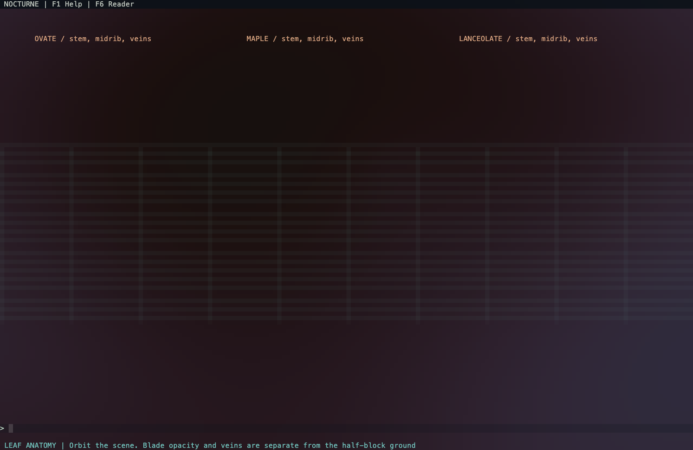

# Materials and rendering

## Cell output

Each output cell has a glyph, foreground RGB, background RGB and semantic ID. RGB values are packed sRGB integers. The renderer resolves scene geometry and pseudo-alpha into those channels before presentation. Present the supplied background first, then the glyph; do not apply alpha a second time.

## Sampling

Cell, half-block, braille and hybrid sampling are explicit choices. Braille is a 2-column by 4-row dot lattice with 256 masks. Full occupancy is U+28FF, eight separated dots, not a solid block. In a braille cell the spaces between dots retain the scene behind the glyph. Browser presentation draws dot geometry directly rather than relying on a system font's substitute glyph.

A floor, a leaf silhouette and a leaf vein can all cross one terminal cell. Depth and object ownership decide which foreground geometry supplies its mask; the background retains lower visible surfaces. Explicit block surfaces retain their sampling when another object uses braille.

## Color and animation

Materials can provide fixed channels or time-varying tracks. Author hue, chroma/lightness, alpha and pattern in the native contract. Keep palette choices shared across the panel and its interaction states. Use restrained ink on dark surfaces; reserve bright color for selection, active values and small accents.

Material changes preserve scene identities and animation clocks. A transparent surface still needs a meaningful background when composed with another layer. Check normal, selected, disabled and high-density states.

## Geometry, surfaces and assets

Meshes and named surfaces provide depth and collision geometry. Flows, water, heat and floating bodies have explicit resource state and query contracts. Imported models retain their full polygon geometry through model records; do not downsample an asset to fit an unrelated fixed collision-mesh pool. Cell art preserves scalar/RGB/semantic cell rows and is distinct from font shaping.
