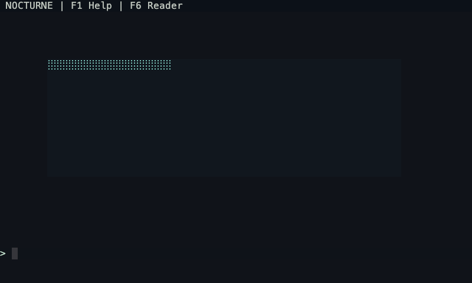

# Python reference

Add `native/bindings/python` to the module path and import `NativeScene` from `nocturne_native`. The loader finds the adjacent SDK core. Pass `library=Path(...)` when your packaging places it elsewhere.

## Runnable example

```python
import json
from pathlib import Path
from nocturne_native import NativeScene

with NativeScene(seed=2030) as scene:
    scene.command(json.loads(Path(__file__).with_name("panel.json").read_text()))
    scene.advance_to(500_000)
    frame = scene.render()
    checkpoint = scene.snapshot()
    scene.command({"op": "widget", "id": 1, "value": 0.8})
    scene.restore(checkpoint)
    assert scene.snapshot() == checkpoint
    print(frame.width, frame.height, len(frame.bytes))
```

From the SDK root:

```sh
PYTHONPATH=native/bindings/python python3 docs/current/examples/panel.py
```

Use a context manager or call `close`. `command(dict)` serializes JSON; `command_raw(bytes)` accepts UTF-8. `batch(list)` is one transaction. `advance_to(time_us)` drains catch-up, `render()` returns a Frame and `info_complete()` returns owned parsed metadata. Optional explicit metadata limits are caller policy.

The prompt-toolkit host owns terminal input and bracketed paste. Restore raw mode and alternate-screen state on normal exit and exceptions. Keep accepted input and rendering as separate host operations.

## Runtime contract

Commands are native transactions. Rejection preserves authoritative state; catch-up pending means more work remains. Serialize operations on one scene. The binding returns copied frames, snapshots and complete metadata. Supply integer microseconds; rendering does not advance time.

The binding grows prompt, model, modal and render storage. Resource IDs and bounded emitter/window/node pools retain their declared native domains; those are separate from document length. Keep the core and binding from a compatible SDK. Use complete metadata when source exceeds ordinary readback capacity.



## Public method index

The shipped binding declares the following methods. Geometry, text and resource query names correspond to the [C declarations](C.md).

- `def source_stage_oklch(self, lightness: int, chroma: int, hue: int)`
- `def source_stage_tween(self, from_value: int, to_value: int, elapsed_ms: int, duration_ms: int, easing: int=1)`
- `def source_stage_ink_opacity(self, age_ms: int, fade_ms: int, row_q8: int, band_q8: int, top_minimum: int)`
- `def source_stage_hit(self, x: int, y: int)`
- `def negotiate_shortcuts(self, actions, candidates, host)`
- `def set_model_records(self, data: bytes)`
- `def model_records(self)`
- `def command_raw(self, text: bytes)`
- `def command(self, value: dict[str, Any])`
- `def advance_to(self, time_us: int, budget: int=240)`
- `def render(self)`
- `def inspect_character_cell(self, x: int, y: int)`
- `def info(self)`
- `def info_complete(self, max_bytes: int | None=None)`
- `def snapshot(self)`
- `def restore(self, data: bytes)`
- `def particles(self)`
- `def surface_foam(self, ident: int)`
- `def hull_immersion(self, vertices, faces, height: float)`
- `def surface_fluid_angular(self, ident: int)`
- `def angular_drag_exchange(self, body_inertia, water_inertia, conductance, seconds, body_omega, water_omega)`
- `def fluid_drag_exchange(self, body_mass, water_mass, conductance, seconds, body_velocity, water_velocity)`
- `def hull_immersion_plane(self, vertices, faces, point, normal)`
- `def hull_buoyancy_plane(self, vertices, faces, point, normal, *, density, gravity, mass, center_of_mass)`
- `def hull_mesh_immersion(self, vertices, faces, water)`
- `def prompt_layout(self)`
- `def prompt_visual_layout(self)`
- `def area_geometry(self, ident: int)`
- `def field_sample(self, ident: int, x: float, y: float)`
- `def water_sample(self, triangle_index: int)`
- `def thermal_sample(self, triangle_index: int)`
- `def surface_foam_transport(self, ident: int)`
- `def flow_thickness(self, ident: int)`
- `def surface_triangles(self, ident: int)`
- `def surface_fluid(self, ident: int)`
- `def float_hull(self, ident: int)`
- `def float_body(self, ident: int)`
- `def surface_wave_sample(self, surface_id: int, x: float, z: float)`
- `def path_sample(self, points, distance: float, *, closed=False, mode='clamp')`
- `def wave_sample(self, waves, x: float, z: float, seconds: float)`
- `def script_runs(self, text: str)`
- `def line_breaks(self, text: str)`
- `def line_break_details(self, text: str)`
- `def grapheme_boundaries(self, text: str)`
- `def grapheme_widths(self, text: str, ambiguous: int=1)`
- `def grapheme_layout(self, text: str, columns: int, ambiguous: int=1)`
- `def text_run_source(self, kind: int, id: int)`
- `def text_run_clusters(self, kind: int, id: int)`
- `def text_run_layout(self, kind: int, id: int, columns: int, ambiguous: int=1)`
- `def text_run_hit(self, kind: int, id: int, columns: int, column: int, row: int, ambiguous: int=1)`
- `def text_run_clip(self, kind: int, id: int, columns: int, x: int, y: int, width: int, height: int, ambiguous: int=1)`
- `def bidi_visual(self, text: str, direction: int=0)`
- `def bidi_lines(self, text: str, ends, direction: int=2)`
- `def document_layout(self, text: str, columns: int, direction: int=2, ambiguous: int=1)`
- `def document_boundaries(self, text: str)`
- `def document_hit(self, text: str, columns: int, column: int, row: int, direction: int=2, ambiguous: int=1)`
- `def document_caret(self, text: str, columns: int, offset: int, affinity: int=1, direction: int=2, ambiguous: int=1)`
- `def bidi_layout(self, text: str, columns: int, direction: int=2, ambiguous: int=1)`
- `def bidi_hit(self, text: str, columns: int, column: int, row: int, direction: int=2, ambiguous: int=1)`
- `def bidi_caret(self, text: str, columns: int, offset: int, affinity: int=1, direction: int=2, ambiguous: int=1)`
- `def selected_text(self)`
- `def grapheme_hit(self, text: str, columns: int, column: int, row: int, ambiguous: int=1)`
- `def particle_motions(self)`
- `def catalogue(self)`
- `def oklch(self, l: float, c: float, h: float)`
- `def composite(self, base: int, source: int, base_alpha: int=65535, source_alpha: int=65535, blend: int=0, operation: int=0, seed: int=0)`
- `def composite_in_space(self, base: int, source: int, space: int, base_alpha: int=65535, source_alpha: int=65535, blend: int=0, operation: int=0, seed: int=0)`
- `def text_sample(self, identity: int, index: int)`
- `def text_cluster_sample(self, identity: int, index: int)`
- `def text_trail_sample(self, identity: int, index: int, trail_index: int)`
- `def window_sample(self, identity: int, u: float, v: float, visibility: float)`
- `def batch(self, commands: list[dict[str, Any]])`
- `def schedule(self, identity: int, at_us: int, command: dict[str, Any])`
- `def cancel_scheduled(self, identity: int)`
- `def set_accessibility(self, *, reduced_motion: bool=False, screen_reader: bool=False)`
- `def close(self)`

[Common command field reference](Commands.md).
