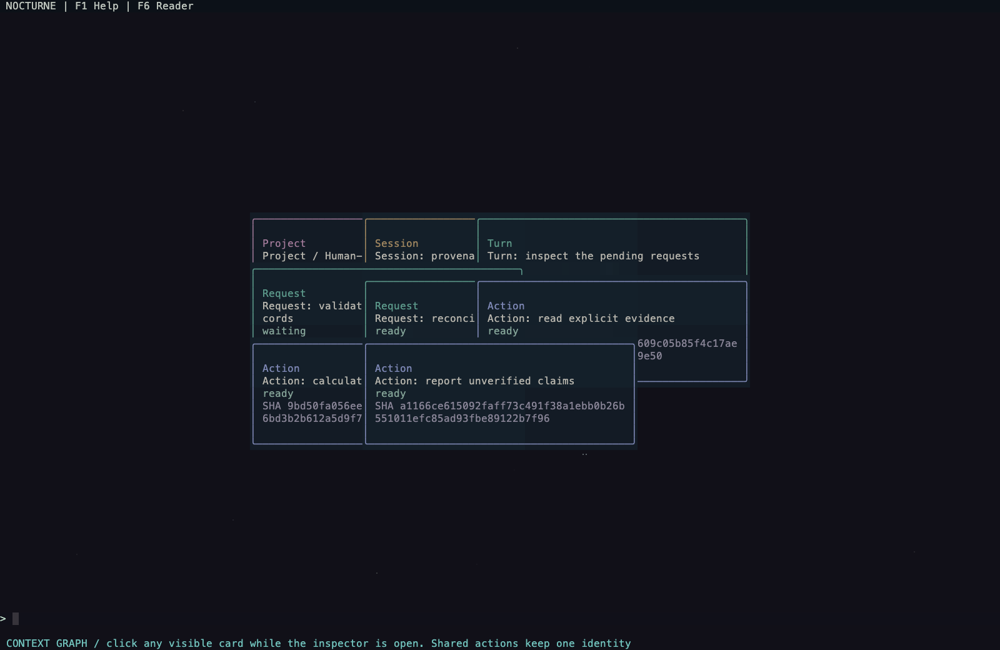

# Web integration

## Load and own the engine

Load `native_scene.mjs` and a matching `nocturne_native.wasm` from your application assets. Fetch WASM as an ArrayBuffer and call `NativeScene.create`. Keep one context per live view, serialize calls to that context, and close it when its view is destroyed. Use a worker for expensive commands when the host needs to stay responsive; transfer owned messages and frames rather than sharing mutable borrowed views.

```javascript
import {NativeScene} from './native_scene.mjs';
const bytes = await fetch('./nocturne_native.wasm').then(r => {
  if (!r.ok) throw new Error(`WASM load failed: ${r.status}`);
  return r.arrayBuffer();
});
const scene = await NativeScene.create(bytes, 2030);
scene.command({op:'resize', width:80, height:24});
scene.command({op:'draft', text:'Ready', caret:5});
const frame = scene.render();
// Present the owned frame; keep scene alive for subsequent input.
```

## Canvas presentation

Allocate the canvas backing size from columns, rows, cell metrics and device pixel ratio. CSS size determines pointer geometry; backing size determines pixels. Do not interpret device pixels as terminal-cell coordinates. Draw each cell background, then its foreground glyph. Use `canvas_braille.mjs` for braille and block geometry. Ordinary glyphs can use the selected font; font loading is asynchronous, and a late completion must not replace a newer user choice.

A frame is not an accessible text tree. Mirror complete source text, values, labels, focus and actionable semantic IDs into a DOM representation. Use native metadata and text queries rather than OCR or character extraction from a clipped screenshot.

## Pointer coordinates and capture

Convert a pointer through `getBoundingClientRect`: cell X is `(clientX-left)*columns/rect.width`, with the corresponding Y expression. Clamp only where the command contract requires it. Native hit ownership and depth choose the recipient. Capture a pointer for an accepted drag, release on pointerup/cancel/lost capture, and never restore a canceled gesture from a stale host flag. Use normal pointer events, not forced clicks, in interaction tests.

For camera wheel input, prevent browser scrolling only while the canvas owns the gesture. Send the wheel delta to the native configured axis action. Keep ordinary page scrolling, keyboard navigation and visible focus outside the stage.

## Text input and IME

Use a real textarea/input for keyboard text and selection. Track compositionstart/compositionend and commit accepted text once. JavaScript selectionStart/selectionEnd are UTF-16; translate them to Unicode scalar indices before native selection commands. Translate native scalar caret offsets back when updating the DOM selection. Preserve directional selection and avoid synchronizing the DOM during an active IME composition.

Paste requests are input, not arbitrary authoring code. A modal or reader owns its input even if the prompt textarea remains present in the DOM. Show validation errors adjacent to the control while preserving the rejected draft. Do not turn an allocation error into silent truncation.

## Animation loop

Maintain a monotonic scene target and bound its backlog. Each painted frame accrues the wall time since the previous frame, at most one frame budget less the backlog it already holds, then submits one bounded time command; paint the actual reached time. Never label a partial catch-up as the requested target. When the host cannot keep up, do not accumulate wall time to replay later: count what was not simulated and report that the simulation is behind. A paused view may still need repaint after input or property changes. When resuming after a long hidden-tab interval, use an explicit elapsed-time policy; do not silently reset animation phase.

The Gallery works this way. The frame budget is the recipe's `frameBudget`, else 24 steps (200 ms at 120 Hz), so the simulation keeps real time down to 5 painted frames per second. Nothing accrues while the page is hidden: hidden time is counted separately and the scene resumes where it stopped. The metrics line leads with steps per second and the time behind per second. `native/scripts/check_gallery_pacing.py` asserts this in Chromium: steps per second, bounded catch-up, the backlog after a hidden tab and after a stalled main thread, and the gallery's error channel.

## Authoring UI

Keep the stage visible while the tool column scrolls independently. On narrow screens, move tools below it. Selection, drag, resize and reorder all edit the shared composition model. Numeric geometry controls and keyboard alternatives call the same operation. Undo/redo covers project changes, while text editing retains its own history.

Apply project replacement in a trial native scene with its own seed and owned assets, then swap after successful validation. File imports never evaluate code. Model data, Unicode text and checkpoint bytes are user data; keep them local unless the user explicitly exports or sends them.

## Accessibility and reduced motion

Label every operation and value. Give selection and errors persistent text feedback, keep focus visible, and use meaningful button names. Offer reduced motion and pause without disabling input. Expose a readable view for projected windows, graph nodes and modal content. Thumbnails are navigation aids; their alt text names the component and represented state.

## Deployment and testing

Serve WASM with the correct content type and load it from the same versioned asset set as its bindings. Avoid cross-version cache mixtures. A local portable gallery embeds the runtime and modules; a hosted application can use ordinary modules and HTTP caching.

Test real canvas input at desktop and narrow dimensions, IME/paste/selection, repeated mount/unmount, rejected imports, resize during capture, context loss in the host and paused edits. Compare emitted native cell bytes across C and WASM for deterministic cases. Pixel checks then verify presentation, especially braille gaps and full occupancy. Cell comparisons test core output; pixel checks test its presentation.


